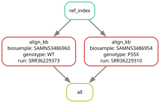
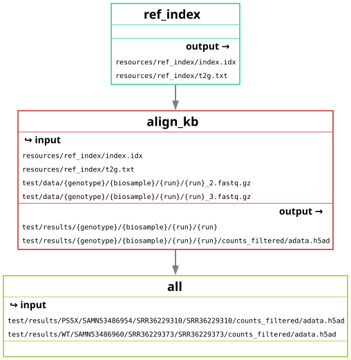

# align-kb

Snakemake pipeline that takes fastq.gz files and a returns a filtered counts matrix in h5ad format. 

Required dependencies to run:

    1. conda
    2. snakemake

Test:

`snakemake --cores 4 --use-conda --configfile "test/config.yaml"`

Run with user provided meta.csv:

`snakemake --cores 4 --use-conda --config META="your/path/meta.csv"`

# **Workflow**

## **Figure 1. Test directed acyclic graph (DAG)**

## **Figure 2. Test file graph DAG**

